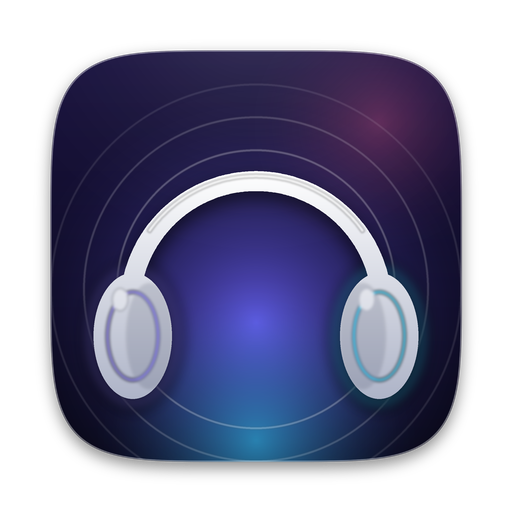
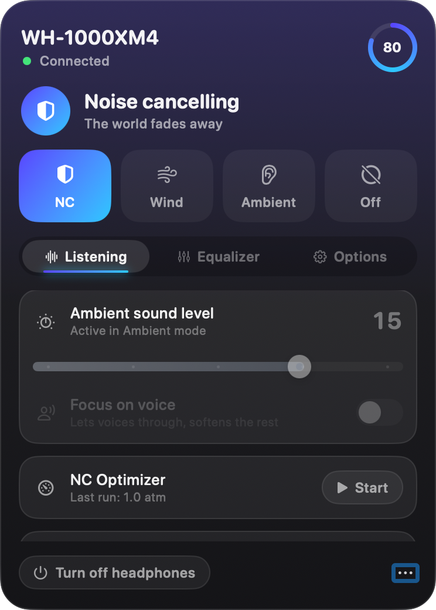
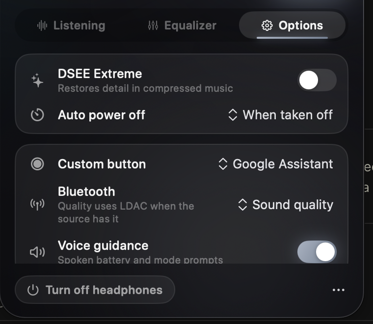

<p align="center">
  
</p>

<h1 align="center">XM4 Connect</h1>

<p align="center">
  <b>Control your Sony WH-1000XM4 from the Mac menu bar — light, native and fast.</b>
</p>

<p align="center">
  <a href="#install"><b>Install</b></a> ·
  <a href="#features">Features</a> ·
  <a href="#troubleshooting">Troubleshooting</a> ·
  <a href="#how-it-works">How it works</a> ·
  <a href="#build-from-source">Build from source</a>
</p>

<p align="center">
  
  
  
  
</p>

<p align="center">
  
  &nbsp;&nbsp;
  
</p>

---

**XM4 Connect is a fork of [XM Connect](https://github.com/omidkrm/xm-connect) by omidkrm, adapted for the WH-1000XM4.**

The original app speaks Sony's MDR protocol **version 2**, which the WH-1000XM5 uses. The WH-1000XM4 speaks **version 1**. It publishes its control channel under a different Bluetooth service UUID and uses different command codes, so the original app never finds it. This fork adds a full protocol-v1 implementation. Every command was checked byte by byte against a real WH-1000XM4 (firmware 2.5.0). It also adds the XM4-only features: Wind Noise Reduction, NC Optimizer, Speak-to-Chat settings, the Custom button, voice guidance and the Bluetooth quality setting.

WH-1000XM5 support from the original is kept: the app picks protocol v1 or v2 from the services the headset publishes.

There is no account, no server, no telemetry and no Electron. It is a small native Swift app that links only against frameworks that ship with macOS.

> XM4 Connect is an independent open-source project. It is **not affiliated with, endorsed by or supported by Sony.**

> **По-русски:** XM4 Connect — это форк XM Connect для Sony WH-1000XM4. Он управляет наушниками из строки меню Mac: все режимы шумоподавления (NC, Wind, Ambient, Off), эквалайзер, NC Optimizer, Speak-to-Chat с настройками, кнопка Custom, голосовые подсказки, громкость при подключении (наушники больше не подключаются тихими), DSEE Extreme, автовыключение и батарея. Установка — одной командой ниже.

## Features

### WH-1000XM4 controls

| | |
| --- | --- |
| 🎧 **All listening modes** | Noise Cancelling, **Wind Noise Reduction**, Ambient Sound and Off. Pick one from the tiles or the right-click menu, or click the mode header to cycle through them |
| 🌬️ **Ambient sound** | Level 1–20 and Focus on Voice |
| 🎯 **NC Optimizer** | Starts the optimizer, shows each step live and the measured air pressure |
| 🎛️ **Equalizer** | All Sony presets plus Manual, Custom 1 and Custom 2. On the editable ones, drag the 5-band curve and the Clear Bass slider |
| 💬 **Speak-to-Chat** | On/off, voice detection sensitivity (Auto/High/Low), when to end (15 s, 30 s, 1 min, or never) and voice focus |
| 🔘 **Custom button** | Ambient Sound Control, Google Assistant or Amazon Alexa |
| 📶 **Bluetooth connection** | Priority on sound quality (LDAC) or on a stable connection |
| 🗣️ **Voice guidance** | On or off |
| ⏸️ **Pause when taken off** | The headset's own setting |
| ✨ **DSEE Extreme** | On or off |
| ⏲️ **Auto power off** | When taken off, 5 min to 3 h, or never |
| 🔊 **Volume on connect** | macOS often brings the headphones back far too quiet. When they connect, the app sets the Mac's output volume to the level you choose (Options tab), then sets it again over the next 10 seconds, because macOS restores its remembered volume late |
| 🔋 **Battery** | Level and charging state in the panel and, if you want, next to the menu bar icon |
| 🪫 **Light on battery** | About 0 % CPU whether the panel is open or closed: no 3D scene and no continuous animations, and the headset is only polled for its battery (it announces every other change itself) |
| ℹ️ **Device info** | Firmware version and the codec in use (SBC / AAC / LDAC) |
| ⏻ **Power off** | Turn the headphones off from the Mac |
| 🔄 **Two-way sync** | Change a mode with the button on the headphones and the app follows instantly |
| 🔌 **Auto-reconnect** | Turn the headphones off and on again; the app finds them by itself |

### Interface

- **A compact panel**: the current mode as a coloured badge, four mode tiles, then three tabs. No 3D scene and no continuous animations, so it costs next to nothing to keep open.
- **Colour follows the mode**: violet for noise cancelling, teal for wind, amber for ambient, grey for off.
- **English and French.**
- **Demo mode**: a simulated WH-1000XM4, so you can try every control without headphones.

## Install

You need **macOS 13 Ventura or newer**, on Apple silicon or Intel.

### Option 1 — One line in Terminal

```bash
curl -fsSL https://raw.githubusercontent.com/lanceqqe/xm4-connect/main/install.sh | bash
```

[The script](install.sh) downloads the latest release, **checks its SHA-256**, copies *XM4 Connect* into `/Applications` and opens it.

### Option 2 — Installer or disk image

Download `XM4-Connect-Installer.pkg` or `XM4-Connect.dmg` from the [**latest release**](https://github.com/lanceqqe/xm4-connect/releases/latest). The app is not notarized by Apple, so allow it once: **System Settings › Privacy & Security › Open Anyway** (macOS 15+), or right-click › **Open** (macOS 13–14).

### Option 3 — Build it yourself

```bash
xcode-select --install            # once
git clone https://github.com/lanceqqe/xm4-connect.git
cd xm4-connect
make install                      # builds and copies "XM4 Connect.app" to /Applications
open "/Applications/XM4 Connect.app"
```

### First launch

1. Look for the **headphones icon** in the menu bar. There is no Dock icon and no window.
2. **Allow Bluetooth** when macOS asks.
3. Make sure your WH-1000XM4 is **connected** to this Mac, not just paired.

### Uninstall

Quit the app, delete *XM4 Connect* from Applications, then optionally:

```bash
defaults delete app.xm4connect.mac
rm -rf ~/Library/Logs/XM4\ Connect
```

## Usage

| Action | How |
| --- | --- |
| Open the panel | **Left-click** the menu bar icon |
| Quick actions (mode, demo, open at login, quit) | **Right-click** the menu bar icon |
| Next listening mode | **Click** the mode header |
| Close the panel | **Esc**, or click anywhere else |
| Turn the headphones off | **Turn off headphones** at the bottom, then confirm |
| Logs, demo mode, quit | **⋯** button at the bottom right |

The panel has three tabs:
- **Listening**: ambient level, Focus on Voice, NC Optimizer, Speak-to-Chat and its settings, pause when taken off.
- **Equalizer**: presets and the curve editor.
- **Options**: DSEE Extreme, auto power off, Custom button, Bluetooth quality, voice guidance, volume on connect, device info, language, battery in the menu bar, open at login.

### Pause when taken off

On the WH-1000XM4 the headset pauses and resumes playback itself, through its proximity sensor. The switch in the Listening tab turns that setting on or off.

### Launch arguments

| Argument | Effect |
| --- | --- |
| `--demo` | Start with the simulated headset |
| `--open` | Open the panel right away |
| `--verbose` | Mirror the log to the terminal |

```bash
open "/Applications/XM4 Connect.app" --args --demo
```

## Troubleshooting

| Symptom | Fix |
| --- | --- |
| *"Connect the headphones to this Mac"* | They are paired but not connected. Connect them from the Bluetooth menu or Control Center |
| *"Headphones not found"* | Turn the headphones on; make sure they appear in System Settings › Bluetooth |
| Nothing ever connects | System Settings › Privacy & Security › **Bluetooth**: XM4 Connect must be allowed |
| Controls work on the phone but not on the Mac | Multipoint: make sure the headphones are actively connected to the Mac too |
| A setting jumps back | The headphones rejected it; the app re-reads their state so it never shows a value they do not have. Please open an issue with the log |
| macOS says the app can't be verified | Install with [Option 1](#option-1--one-line-in-terminal-recommended), or allow it once with *Open Anyway* ([steps](#option-2--installer-or-disk-image)) |

The log is at `~/Library/Logs/XM4 Connect/app.log`; open it from **⋯ › Open the log**. To include the raw protocol traffic, which is the most useful thing to attach to a bug report, turn it on and restart the app (it is off by default to save battery):

```bash
defaults write app.xm4connect.mac debugLog -bool YES
```

## How it works

Sony headphones expose a classic-Bluetooth **RFCOMM** control service. Its UUID depends on the protocol generation:

| Protocol | Headphones | Service UUID |
| --- | --- | --- |
| v1 | WH-1000XM4 | `96CC203E-5068-46AD-B32D-E316F5E069BA` |
| v2 | WH-1000XM5 and newer | `956C7B26-D49A-4BA8-B03F-B17D393CB6E2` |

XM4 Connect looks for both and picks the protocol from the one it finds. Both generations share the same framing:

```
3E | type | seq | length (4 bytes, big-endian) | payload | checksum | 3C
```

- Bytes `3C`, `3D` and `3E` inside the frame are escaped with `3D`.
- The checksum is the 8-bit sum of everything between the markers.
- Every data frame is acknowledged with an `ACK` (`type 01`) carrying the next sequence number.
- Type `0C` carries main ("table 1") messages and `0E` carries secondary ("table 2") ones.

### WH-1000XM4 messages (protocol v1)

All of these were verified on a WH-1000XM4 with firmware 2.5.0. Unlike v2, booleans are `01` = on.

| Function | Read | Write | Reply / notification |
| --- | --- | --- | --- |
| Protocol info | `00 00` | — | `01 00 <ver> 00` |
| Firmware | `04 02` | — | `05 02 <len> <ascii>` |
| Battery | `10 00` | — | `11/13 00 <level> <charging>` |
| Codec | `18 00` | — | `19/1B 00 <01 SBC, 02 AAC, 10 LDAC>` |
| NC / Wind / Ambient / Off | `66 02` | `68 02 <00 off, 11 on> 02 <02 NC, 01 wind, 00 amb> 01 <voice> <level>` | `67/69 02 <on> 02 <mode> 01 <voice> <level>` |
| Equalizer | `56 01` | preset: `58 01 <preset> 00`; bands: `58 01 FF 06 <cb> <b1>…<b5>` (value + 10) | `57/59 01 <preset> 06 …` |
| NC Optimizer | `86 01` | `84 01 00 <01 start, 00 stop>` | progress `85 01 xx <status>`, result `87/89 01 … <atm × 10>` |
| Sound quality / connection | `E6 01` | `E8 01 00 <00 quality, 01 connection>` | `E7/E9 01 00 <value>` |
| DSEE Extreme | `E6 02` | `E8 02 00 <on>` | `E7/E9 02 00 <on>` |
| Pause when taken off | `F6 03` | `F8 03 00 <on>` | `F7/F9 03 00 <on>` |
| Auto power off | `F6 04` | `F8 04 01 <a> <b>` | `F7/F9 04 01 <a> <b>` |
| Speak-to-Chat | `F6 05` | `F8 05 01 <on>` | `F7/F9 05 <00/01> <on>` |
| Speak-to-Chat settings | `FA 05` | `FC 05 00 <sensitivity> <voice focus> <timeout>` | `FB/FD 05 00 …` |
| Custom button | `D6 D1` | `D8 D1 01 <00 ambient, 01 Google, 02 Alexa>` | `D7/D9 D1 01 <function>` |
| Voice guidance (table 2) | `46 01 01` | `48 01 01 <on>` | `47/49 01 01 <on>` |
| Power off | — | `22 00 01` | — |

Auto power off codes: `00 00` 5 min, `01 01` 30 min, `02 02` 1 h, `03 03` 3 h, `10 00` when taken off, `11 00` never.

Two details differ from the published reference layouts: the Custom button only accepts `D8 D1 01 …` (not `02`), and the EQ band write only takes effect with preset `FF` ("the active preset"). The touch-panel on/off command (`D8 D2`) is acknowledged but ignored by this firmware, so the app does not offer it.

The WH-1000XM5 (protocol v2) messages from the original project are unchanged; see [XM Connect](https://github.com/omidkrm/xm-connect#how-it-works).

The protocol core (`SonyProtocolKit`) is pure Swift with no platform dependencies, and is covered by a test suite (`make test`) that includes the exact bytes captured from a WH-1000XM4.

### Project layout

```
Sources/
  SonyProtocolKit/      framing, v1 (XM4) and v2 (XM5) commands and parsing (pure Swift, tested)
  SonyProtocolTests/    protocol test suite (no XCTest needed)
  XMConnect/
    Bluetooth/          IOBluetooth RFCOMM transport, session, reconnect loop
    Model/              app state, translations, demo headset, media pause, logging
    UI/                 menu bar panel, controls, equalizer, tabs
Resources/              Info.plist, localized InfoPlist.strings, app icon
installer/              .pkg screens (EN/FR), install scripts, disk image background
scripts/                icon renderer (Python), disk image window layout
install.sh              one-line installer
```

## Build from source

You need the **Xcode Command Line Tools** (`xcode-select --install`). The full Xcode is not required: the Makefile drives `swiftc` directly.

| Command | Result |
| --- | --- |
| `make` | `build/XM4 Connect.app` for this Mac |
| `make run` | Build and launch |
| `make demo` | Build and launch in demo mode |
| `make install` | Copy to `/Applications` |
| `make test` | Run the protocol test suite |
| `make universal` | Apple silicon + Intel build |
| `make pkg` | `build/XM4 Connect Installer.pkg` |
| `make dmg` | `build/XM4 Connect.dmg` |
| `make zip` | `build/XM4-Connect-macos.zip` (what `install.sh` downloads) |
| `make clean` | Remove `build/` |

`Package.swift` is there so you can browse and edit the code in Xcode. Run the real app with `make`, though: macOS only shows the Bluetooth prompt for a proper `.app` bundle with its `Info.plist`.

The app icon is drawn by `scripts/render_icon.py` (Pillow + NumPy). The generated PNGs are committed, so Python is not needed to build.

### Releasing

Bump `CFBundleShortVersionString` in `Resources/Info.plist` (for example to `1.2.0`) and push to `main`. Pushing a `v1.2.0` tag works too.

When `main` carries a version that has no release yet, the [release workflow](.github/workflows/release.yml):
1. runs the tests;
2. builds the universal app, zip, installer and disk image;
3. publishes them as a GitHub release, creating the `vX.Y.Z` tag.

## Contributing

Issues and pull requests are welcome. For protocol changes, please add a test in `Sources/SonyProtocolTests` with the exact bytes, ideally captured from the headset (the log at `~/Library/Logs/XM4 Connect/app.log` has the raw traffic).

## Credits

XM4 Connect is a fork of **[XM Connect](https://github.com/omidkrm/xm-connect)** by omidkrm (MIT). Everything except the WH-1000XM4 support comes from it.

The WH-1000XM4 message layouts started from **[Gadgetbridge](https://codeberg.org/Freeyourgadget/Gadgetbridge)**'s Sony protocol v1 implementation (only the byte layouts were used, no code) and were then verified on the headset.

XM Connect itself is built on two open-source projects, both MIT-licensed:

- **[sony-tray](https://github.com/abhiinhii/sony-tray)** by Abhinav ([@abhiinhii](https://github.com/abhiinhii)) and contributors. It provided the framing, noise control, equalizer, battery, the IOBluetooth transport, the session and reconnect logic, and the test suite, all verified on a WH-1000XM5. Files taken from it are marked at the top.
- **[SonyHeadphonesClient](https://github.com/mos9527/SonyHeadphonesClient)** by mos9527, Amr Satrio and contributors. It provided the message layouts for Speak-to-Chat, DSEE, pause when taken off, auto power off and the wearing status.

Their licences are in [`THIRD_PARTY_LICENSE_sony-tray.txt`](THIRD_PARTY_LICENSE_sony-tray.txt) and [`THIRD_PARTY_LICENSE_SonyHeadphonesClient.txt`](THIRD_PARTY_LICENSE_SonyHeadphonesClient.txt).

## Disclaimer

XM4 Connect is not affiliated with, endorsed by or supported by Sony Group Corporation. "Sony", "WH-1000XM4", "WH-1000XM5", "Sound Connect", "DSEE Extreme", "Speak-to-Chat" and "Clear Bass" are trademarks of Sony Group Corporation, used here only to describe compatibility.

The software is provided as is, without warranty. It only sends commands that were verified on the headphones, but use it at your own risk.

## License

[MIT](LICENSE)
